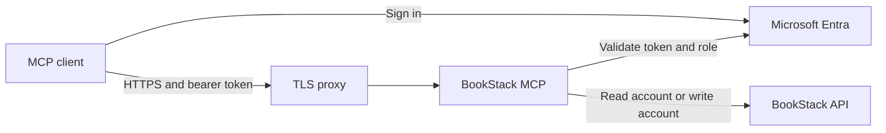

# Deployment runbook

[Documentation index](README.md) · [Configuration reference](CONFIGURATION.md) · [Client setup](CLIENTS.md) · [Troubleshooting](TROUBLESHOOTING.md)

This guide covers a private Docker service and a public HTTPS connector with Microsoft Entra sign-in. For a local desktop/CLI installation, use [stdio client configuration](CLIENTS.md).

## Choose the access boundary

| Deployment | Who can call it? | BookStack access |
|---|---|---|
| Internal HTTP without OAuth | Anyone able to reach the service | Shared configured token; writes default off |
| Public HTTP with Entra OAuth | Users admitted by the Entra app and presenting a valid bearer token | Shared read/write service account selected by role |

HTTP without OAuth has no built-in caller authentication. Keep it on a trusted private network, or supply an authenticated gateway. `MCP_HTTP_ALLOWED_HOSTS` validates the destination hostname; it does not authenticate users.

Entra users do not automatically get their own BookStack permissions. Read the [credential matrix](CONFIGURATION.md#credentials-and-permissions) before admitting users to a shared service. Optional per-request BookStack headers require separate client configuration and retain an environment-account fallback.

## Images and prerequisites

Public release images are available at `ghcr.io/ttpears/bookstack-mcp` for Linux amd64 and arm64; ordinary public pulls do not need a GHCR token. Use a fixed release such as `:5.7.1` for reproducible deployment. `:5.7` and `:latest` move as releases are published. Pin an image digest when exact image identity is required.

Non-draft, same-repository PRs also publish amd64 preview images named `:branch-<sanitized-branch-name>`. Fork PRs build without publishing; drafts skip previews. Previews are for testing and do not publish npm packages.

Before deploying:

1. Install Docker with Compose and provide network access to BookStack.
2. Create a dedicated **read-only** BookStack account/token with **Access System API**, appropriate view permissions, and **Export Content** for Markdown fallback. Keep the Token ID and Secret separately.
3. If OAuth writers are needed, create a different write-capable account/token with limited scope. Do not give the base read account write permissions.
4. Store credentials in a protected `.env` alongside Compose, or your platform's secret mechanism. Never commit the populated file. Compose reads `.env` for interpolation; the Node application does not automatically load it.

## Internal HTTP service

This example assumes LibreChat already uses a Docker network named `librechat`. Check its actual network name with your deployment configuration and adjust both services to share it.

Create `.env` with the three required BookStack values from [`.env.example`](../.env.example). The `${VARIABLE:?}` expressions make Compose stop with its built-in error if a required value is unset or empty. Save this as `compose.yml`:

```yaml
services:
  bookstack-mcp:
    image: ghcr.io/ttpears/bookstack-mcp:5.7.1
    restart: unless-stopped
    environment:
      MCP_TRANSPORT: "http"
      MCP_HTTP_HOST: "0.0.0.0"
      MCP_HTTP_PORT: "8080"
      MCP_HTTP_ALLOWED_HOSTS: "bookstack-mcp,localhost,127.0.0.1"
      BOOKSTACK_BASE_URL: "${BOOKSTACK_BASE_URL:?}"
      BOOKSTACK_TOKEN_ID: "${BOOKSTACK_TOKEN_ID:?}"
      BOOKSTACK_TOKEN_SECRET: "${BOOKSTACK_TOKEN_SECRET:?}"
      BOOKSTACK_ENABLE_WRITE: "false"
    networks: [librechat]
networks:
  librechat:
    external: true
```

No host port is published. Configure LibreChat with the [Streamable HTTP entry](CLIENTS.md#streamable-http) pointing to `http://bookstack-mcp:8080/mcp`, then start and verify:

```bash
docker compose config --quiet
docker compose up -d bookstack-mcp
docker compose ps
docker compose exec bookstack-mcp wget -qO- http://localhost:8080/health
```

The last command should return JSON containing `"status":"ok"`. Next, call `get_books` through LibreChat to test actual BookStack credentials. Review local logs if needed, but redact them before sharing. Do not expose this unauthenticated service on a public host port.

For a temporary **host-only** test, you can add `ports: ["127.0.0.1:8080:8080"]` and use an HTTP MCP client on that host. A container must still bind `0.0.0.0` internally for forwarded connections. Remove the port mapping when finished if it is unnecessary.

## Public connector with Entra OAuth

Use one public HTTPS origin such as `https://mcp.example.com`, served by a TLS reverse proxy that can reach the MCP container on a private network. The Entra app and all URL settings must use the same origin.



### Register the Entra application

An administrator configures this once in the [Entra admin center](https://entra.microsoft.com):

1. Under **App registrations**, create a single-tenant application, e.g. *BookStack MCP Connector*. Add a **Web** redirect URI of `https://mcp.example.com/callback` — the public origin followed by `/callback`.
2. Record **Application (client) ID** as `OAUTH_CLIENT_ID` and **Directory (tenant) ID** as `OAUTH_TENANT_ID`.
3. Under **Certificates & secrets**, create a client secret. Copy its **Value**, not its secret ID, into `OAUTH_CLIENT_SECRET`. Track its expiry for rotation.
4. Under **Expose an API**, set the Application ID URI (normally `api://<client-id>`) and create an enabled delegated scope such as `user_impersonation`. Set `OAUTH_AUDIENCE` if using a different URI. The default upstream request uses the resource's `/.default` scopes.
5. Under **App roles**, create an enabled role with value `Writer`, allowed for **Users/Groups**. Match `OAUTH_WRITE_ROLE` if choosing another value. This role unlocks MCP write tools; the separate BookStack account determines actual API permissions.
6. Configure the API to issue v2 access tokens (`api.requestedAccessTokenVersion: 2` in the current manifest schema; older portal schemas used `accessTokenAcceptedVersion`). Save and verify the resulting token audience against your application configuration.
7. Review delegated `openid`, `profile`, and `offline_access` permissions and consent requirements for your tenant. Grant the necessary administrator consent.
8. In **Enterprise applications**, enable **Assignment required** and assign only intended users/groups. Assign `Writer` only to writers. Assign readers an available non-write role; if the portal no longer offers default access after defining roles, create a `Reader` role and assign it. Any role other than the configured write-role value remains read-only to MCP.

Entra portal labels can vary. Validate with separate reader and writer accounts instead of treating a successful admin login as proof of correct assignments. Role changes become visible when the presented token's claims change; existing access tokens can retain old claims until refreshed or expired.

### Configure the service and TLS proxy

Add the OAuth values to your private `.env`. For this example, the proxy already uses an external Docker network named `edge` and routes `mcp.example.com` to `bookstack-mcp:8080`.

```yaml
services:
  bookstack-mcp:
    image: ghcr.io/ttpears/bookstack-mcp:5.7.1
    restart: unless-stopped
    environment:
      MCP_TRANSPORT: "http"
      MCP_HTTP_HOST: "0.0.0.0"
      MCP_HTTP_PORT: "8080"
      MCP_HTTP_ALLOWED_HOSTS: "mcp.example.com,bookstack-mcp,localhost,127.0.0.1"
      MCP_OAUTH_ENABLE: "true"
      MCP_SERVER_URL: "https://mcp.example.com"
      OAUTH_TENANT_ID: "${OAUTH_TENANT_ID:?}"
      OAUTH_CLIENT_ID: "${OAUTH_CLIENT_ID:?}"
      OAUTH_CLIENT_SECRET: "${OAUTH_CLIENT_SECRET:?}"
      OAUTH_WRITE_ROLE: "Writer"
      BOOKSTACK_BASE_URL: "${BOOKSTACK_BASE_URL:?}"
      BOOKSTACK_TOKEN_ID: "${BOOKSTACK_TOKEN_ID:?}"
      BOOKSTACK_TOKEN_SECRET: "${BOOKSTACK_TOKEN_SECRET:?}"
      BOOKSTACK_WRITE_TOKEN_ID: "${BOOKSTACK_WRITE_TOKEN_ID:-}"
      BOOKSTACK_WRITE_TOKEN_SECRET: "${BOOKSTACK_WRITE_TOKEN_SECRET:-}"
    networks: [edge]
networks:
  edge:
    external: true
```

Leaving both write-token variables empty makes all sessions read-only, including users with `Writer`. `BOOKSTACK_ENABLE_WRITE=true` does not substitute for them in OAuth mode.

Configure the proxy to:

- Terminate HTTPS and forward the original public `Host`, allowing that host in `MCP_HTTP_ALLOWED_HOSTS`.
- Route the whole origin, including `/.well-known/*`, `/register`, `/authorize`, `/callback`, `/token`, and `/mcp`. Do not place an incompatible interactive proxy login in front of OAuth discovery and callbacks.
- Forward MCP POST, streaming GET, and DELETE requests, preserving `Authorization`, `Mcp-Session-Id`, `MCP-Protocol-Version`, content negotiation, and response session headers. Support streaming responses without buffering them until close.
- Allow sufficient time for API calls and streams. A tool can make multiple BookStack requests, each with a default 60-second total budget; a short proxy timeout can cut off otherwise valid calls.
- Apply appropriate connection/request limits and redact credential-bearing headers. Do not rely on `MCP_TRUST_PROXY` for forwarded-IP handling; it currently has no active effect.

Proxy-specific routing, certificates, and network creation remain operator configuration. Keep port 8080 private. If your proxy sends its backend hostname instead of the public host, adjust it or the allowlist deliberately.

### Verify before admitting users

After `docker compose config --quiet` and `docker compose up -d bookstack-mcp`, check discovery and the unauthenticated boundary:

```bash
curl --fail-with-body https://mcp.example.com/.well-known/oauth-protected-resource
curl --fail-with-body https://mcp.example.com/.well-known/oauth-authorization-server
curl -i -X POST https://mcp.example.com/mcp \
  -H 'Content-Type: application/json' \
  -d '{"jsonrpc":"2.0","method":"initialize","id":1}'
```

Discovery must advertise the intended HTTPS origin. The unauthenticated MCP call must return **401** with a `WWW-Authenticate: Bearer` resource-metadata hint. A 200 liveness check alone proves neither OAuth nor BookStack authorization.

Add `https://mcp.example.com/mcp` in Claude's custom connector settings (or another OAuth-capable MCP client). Sign in as a reader, list/read known allowed content, and confirm write tools are absent. If configured, sign in separately as a writer, edit disposable content, and verify it in BookStack. Confirm an unassigned Entra user cannot sign in. See [troubleshooting](TROUBLESHOOTING.md#oauth-and-authorization) for token/audience failures.

## Persistence, restarts, and scaling

The default broker state is in memory: restarting loses dynamic client registrations, pending sign-ins, and unused codes. Set `REDIS_URL` to use a private Redis service if those records must persist across application restarts. Redis needs its own access controls, backups/persistence policy, and optional TLS; do not publish it publicly.

Redis stores **OAuth broker state**, not live MCP sessions. Multiple replicas require both shared broker state and MCP session affinity. Restarted or expired sessions return 404 so the client can initialize again. Use one replica unless your load balancer and clients have been validated for this behavior.

Observe container health, restarts, memory/session counts, BookStack 429s, and OAuth failures without logging tokens or page bodies. HTTP `/health` includes live session count and process RSS; keep monitoring access appropriate to your deployment. If you change `MCP_HTTP_PORT`, update the container healthcheck too: the image's default check targets port 8080.

## Upgrade and rollback

1. Read the [release notes](https://github.com/ttpears/bookstack-mcp/releases), record the current image version/digest and protected configuration, and test the new image with read-only access.
2. Change the pinned image tag, then run `docker compose pull bookstack-mcp` and `docker compose up -d bookstack-mcp`.
3. Check health, reconnect a client, read a known page, and verify reader/writer behavior. A restart invalidates live sessions even when Redis is configured.
4. To roll back the server, restore the previous image reference and redeploy. Reconnect clients. Rolling back the server does not undo edits already made in BookStack; use page history, the recycle bin where supported, or BookStack backups for content recovery.

For maintainers publishing a new version, use the [release runbook](RELEASING.md). Deployment and release approval are separate operations.
